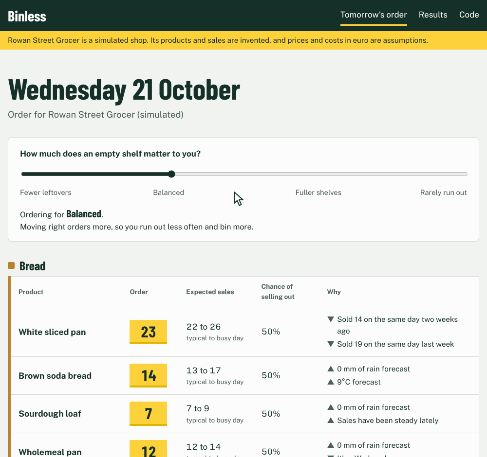
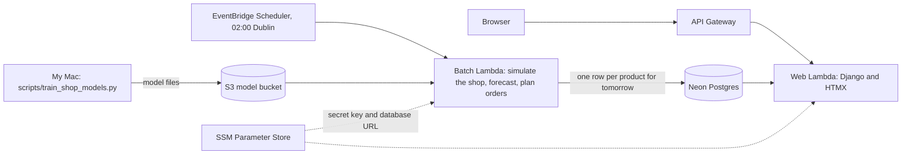

# Binless


Binless tells an independent grocer how much of each fresh product to order for tomorrow, explains why in plain English, and measures the waste it avoids.

I'm building it as a portfolio project while learning Python. It's a work in progress, and this README describes what exists today.

Live app: [a9lersj3kf.execute-api.eu-west-2.amazonaws.com](https://a9lersj3kf.execute-api.eu-west-2.amazonaws.com/). The order page is for Rowan Street Grocer, a simulated shop: every product and sale on it is invented, and its prices and costs are assumptions. The first visit after a quiet spell takes a few seconds while the server starts.



Moving the slider towards fuller shelves raises the orders and lowers each product's chance of selling out.

## Why

Fresh food that isn't sold by its date is thrown away, and a product that sells out loses sales for the rest of the day. Binless gives a shop owner a forecast range for each product and turns it into an order quantity that weighs the cost of waste against the cost of an empty shelf.

## Results so far

The test period is the last four weeks of a random 50-store sample of FreshRetailNet-50K (seed 42). The models retrain before each week, using only earlier days. The dataset's sales are normalised, so the figures are ratios rather than units or euro. To reproduce them, run `python scripts/download_frn.py`, then `python -m scripts.benchmark`, which takes about a minute.

### Forecast accuracy

| Method | WAPE, all days | WAPE, fully stocked days |
| --- | --- | --- |
| Same day last week | 0.426 | 0.421 |
| 7-day moving average | 0.347 | 0.333 |
| LightGBM median forecast (P50) | 0.319 | 0.307 |

WAPE is the total absolute error divided by total sales, so lower is better.

### Orders

| Policy | Waste | Days that ran short | Demand served |
| --- | --- | --- | --- |
| Order last week's sales | 20.6% | 43.6% | 78.2% |
| Order the LightGBM median (P50) | 14.6% | 47.4% | 83.7% |
| Order the LightGBM 80th percentile (P80) | 28.3% | 19.6% | 94.5% |

These figures are for fully stocked days, where demand equals recorded sales. Ordering the median forecast instead of last week's sales cuts waste from 20.6% to 14.6% of what's ordered and serves more of the demand, with slightly more days that run short. Ordering the 80th percentile trades extra waste for fewer empty shelves, and the shop owner chooses the balance. Across all days, with demand estimated by the stockout correction below, the median forecast cuts waste from 14.6% to 9.9%.

### Held-out week, against the dataset authors' models

The dataset's authors forecast each day of the held-out evaluation week from the end of the train split and score only stockout-free periods, across all 898 stores. I ran LightGBM once under the same protocol, with every feature at least 7 days old. I counted a day as stockout-free when none of its trading hours (06:00 to 22:00) was out of stock, since the paper doesn't spell out its exact rule. The authors' figures come from Table 3 of their [paper](https://arxiv.org/abs/2505.16319), and I didn't rerun their code. To reproduce mine, run `python scripts/download_frn.py --n-stores 898`, then `python -m scripts.holdout_eval`, which takes a few minutes.

| Model | Trained on | WAPE | WPE (bias) |
| --- | --- | --- | --- |
| Same day last week (mine) | Recorded sales | 38.91% | -0.77% |
| LightGBM median forecast (mine) | Recorded sales | 31.57% | -10.13% |
| SSA (authors) | Recorded sales | 31.97% | -10.50% |
| TFT (authors) | Recorded sales | 31.75% | -7.37% |
| DLinear (authors) | Recorded sales | 31.56% | -4.89% |
| TFT (authors) | Demand recovered by TimesNet | 29.02% | 2.58% |

On recorded sales, my model matches the authors' baselines on accuracy and under-forecasts more than their TFT and DLinear. Their best model, trained on demand recovered by a learned model, has a WAPE 2.55 points lower. In my own backtest, training on my simpler stockout correction didn't improve accuracy, so a learned recovery model is the next thing to try.

### Stockouts hide demand

In the sample, 44.1% of store-product days had at least one out-of-stock hour during trading hours, and 19.8% of trading hours were out of stock. These figures come from `notebooks/01_explore_frn.ipynb`.

The stockout correction divides each day's sales by the share of a normal day's sales that falls in the hours the product was in stock, using its category's usual hourly pattern for that kind of day (weekday or weekend). When I hid the later hours of fully stocked days, it recovered the hidden sales with a bias of +0.8% (`python -m scripts.validate_stockout_correction`). On the 94.0% of days it can estimate, it puts demand at 1.25 times recorded sales.

That figure is probably too high. Training LightGBM on corrected demand moved its bias against recorded sales from -2.5% to +14.5% and left it over-forecasting fully stocked days by 13.6%. In a different setup, the dataset's authors report a bias of +0.57% to +2.58% on stockout-free periods for their best model after learned demand recovery ([paper](https://arxiv.org/abs/2505.16319)). Splitting the hourly profiles into weekdays and weekends didn't change the estimate. The corrected model's median forecast wasted 21.2% and ran short on 34.5% of fully stocked days, between the recorded-sales model's median and 80th percentile, so Binless orders from the model trained on recorded sales.

## How it works



Each night the batch Lambda regenerates the simulated shop's history up to today, runs the trained LightGBM models on tomorrow's row for each product, and saves the forecast range, an order for each slider position and the top two reasons. The web Lambda only reads those rows: it never runs a model, so its image has no pandas or LightGBM, and a test fails if web code imports them. Both run the same Django and forecasting code as my laptop. Training happens on my Mac, and each trained version gets its own folder in S3.

The order rule is the newsvendor critical ratio. For each category, the ratio of the margin lost on an empty shelf to the cost of a binned unit picks a point in the forecast range. The slider weights an empty shelf from half to four times the lost margin, for owners who worry about customers going elsewhere.

More detail is in [docs/](docs/): the [model card](docs/model-card.md), [responsible AI notes](docs/responsible-ai.md), [requirements](docs/requirements.md) and [decision records](docs/decisions/).

## What works so far

- A forecasting package in plain Python, with no Django imports, containing a FreshRetailNet-50K adapter, two baselines, WAPE and bias, leakage-safe features, LightGBM quantile models, the stockout correction, a newsvendor order rule, order outcomes and a simulated shop.
- A Django app with the order page and its slider, a results page with the benchmark charts, and a landing page, deployed on AWS Lambda.
- A nightly batch Lambda that writes tomorrow's order for the simulated shop to Postgres. If it stops running, the order page says the saved order is out of date.
- 63 tests, run by GitHub Actions against Postgres on every push.

## Limitations

- The live shop is simulated, and its history is regenerated on each nightly run, so yesterday's page and today's page don't describe one continuous history.
- The shop's models are trained once and reused each night until I train and deploy a new version.
- Prices and costs per category are my assumptions, not figures from any retailer.
- The newsvendor rule assumes leftovers are thrown away at the end of the day. That fits bread and deli items and only approximates milk and fruit, which keep for a few days.
- The median forecast under-forecasts by 10.13% on the held-out week, and the 80th and 90th percentiles cover less often than their names promise (76.8% and 86.7% of days in the backtest).
- The stockout correction probably overstates lost demand, as described above.
- The backtests use each day's actual weather, which a real forecast wouldn't know.
- The reasons on the order page come from a second, mean-regression model trained on the same features, because LightGBM's per-feature contributions don't add up for quantile models.
- I haven't yet tested the order page with a real shop owner.

## Run it locally

Requires Python 3.12 and Docker. On macOS, LightGBM also needs `brew install libomp`.

```zsh
python3.12 -m venv .venv
source .venv/bin/activate
python -m pip install -r requirements/dev.txt
cp .env.example .env
python -c "import secrets; print(secrets.token_urlsafe(50))"
```

Paste the printed key into `.env` as `DJANGO_SECRET_KEY`. Then start Postgres, train the shop's models, write tomorrow's order and run the site:

```zsh
docker compose up -d db
python manage.py migrate
python -m pytest
python -m scripts.train_shop_models
python manage.py forecast_orders --models models/shop/$(date +%F)
python manage.py runserver
```

To download the data and rerun the benchmark, install the exploration requirements too:

```zsh
python -m pip install -r requirements/explore.txt
python scripts/download_frn.py
python -m scripts.benchmark
```

## Data

The benchmark data is [FreshRetailNet-50K](https://huggingface.co/datasets/Dingdong-Inc/FreshRetailNet-50K) by Dingdong-Inc, licensed under [CC BY 4.0](https://creativecommons.org/licenses/by/4.0/). The download script keeps a random subset of stores, and the adapter renames columns to Binless's own names. The dataset's IDs are encoded and its sales are normalised, so no product names from it appear anywhere in Binless.

The simulated shop (`forecasting/simulation.py`) is generated by my own documented code. Its product names are invented, and none of its numbers come from a real shop.
